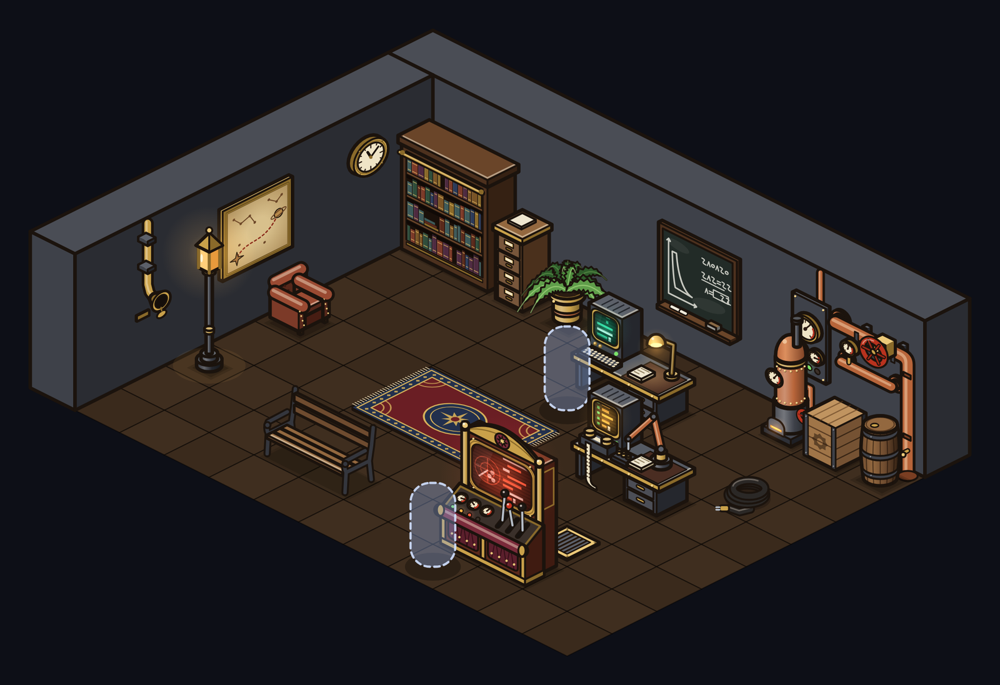
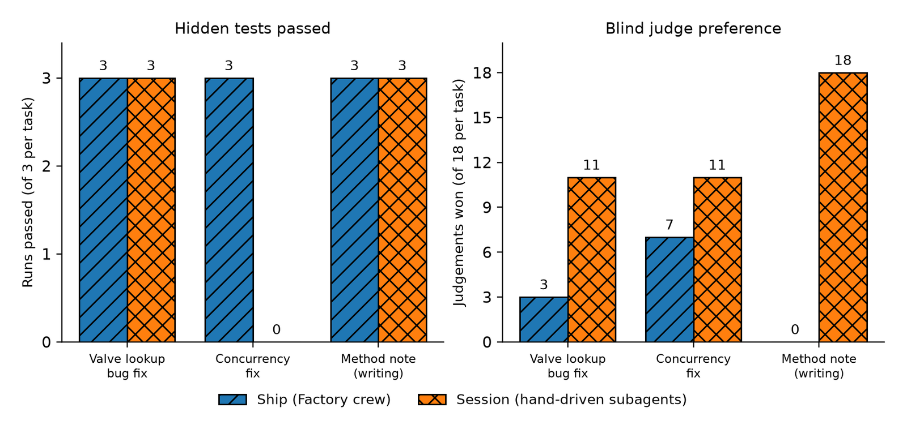

# The Factory

The Factory is a desktop app that turns a team of command-line coding agents into a small crew of robots on a 2.5-D isometric, steam-tech starship. Each robot is a real agent session (Claude Code first, with the engine designed to host other agent CLIs). You command them only from the app: rooms on the ship are ready-made missions, and a mission runs as a structured job with approval gates, so the app can serve as a daily driver in place of a terminal.

## Introduction

https://github.com/user-attachments/assets/c0fdf393-aad6-4680-a3b6-0cb4df4641e4

<em>A real run on a small demo project: the Engineer takes a Quick fix mission, fixes the bug and runs the tests, and the change is reviewed at the keep gate before it is kept (56 s, sped up only between clicks).</em>

  
   <em>A room on the ship, drawn in code.</em>

## Features

- A ship of themed rooms; each room is a mission (for example "Quick fix", "Build it", "Blind review"), and the crew members at their stations do the work.
- Jobs and pipelines: planner, plan gate, engineer, automated gates (tests and checks), critic, keep gate, librarian, with feedback loops that send failed work back to the author.
- Permission prompts from agents appear in the chat, where you allow or deny them, instead of being buried in a terminal.
- Keep/Undo: every file change an agent makes is snapshotted, so any change can be reviewed, kept or rolled back.
- Several projects side by side, each in its own tab.
- Cross-project memory that carries lessons from one project to the next.
- Usage gauges that show how much of your plan's limits and what estimated cost a run has used.
- Per-seat cost controls: model choice, a spending cap per call, and a single-agent shortcut for easy work.
- A built-in benchmark harness for comparing workflows on reference tasks.
- Original art drawn in code: the robots, machines, furniture and the ship itself are vector drawings, with no bitmap sprite packs.

## How it works

A small local engine runs on your machine and starts agent CLIs as child processes. Each agent has a seat (a station on the ship with a role, a model and a set of allowed tools). A mission is a pipeline of seats and gates described in a plain configuration file, so crews and missions can be changed without touching the engine.

While a job runs, the engine streams what each agent does into the chat and journal. When an agent needs permission for a tool call, the request is routed through a small permission service and shown in the chat. Before an agent touches files, the engine takes a snapshot, which is what makes Keep/Undo possible. Critics are read-only and see only the author's deliverable, not its working notes, so their review is blind. At the end, a librarian seat records what was learned into memory for other projects.

The interface is a single canvas scene plus panels; the desktop app wraps the same engine and interface in a native window. Agents use your existing subscription login; the engine does not handle API keys.

## Benchmark

The same reference tasks were given to The Factory's agent crew ("ship", the planner, engineer, gates and critics pipeline) and to a hand-driven Claude Code session using the subagent method ("session": a brief to a builder subagent, an independent reviewer, one fix round if needed). Every output was graded two ways: hidden tests the agents never saw, and blind judges (Claude Fable models, outputs anonymised, free to apply the diffs and run the tests). The sample is small: 3 tasks, 3 runs per workflow per task (9 runs each), 54 blind judgements in total.

  
   <em>Ship vs session: same tasks, hidden tests and blind judges.</em>

### Ship vs session

| Task | Ship: hidden tests | Session: hidden tests | Ship: wall time per run | Ship: cost per run (list-price equivalent) | Judges: ship / session / tie |
|---|---|---|---|---|---|
| Valve lookup bug fix, with a required regression test | 3/3 | 3/3 | 68 s (Sonnet authors), 90-93 s (Opus authors) | $0.27 (Sonnet), $0.46 (Opus) | 3 / 11 / 4 |
| Concurrency fix (close a stream inside a lock) | 3/3 | 0/3 | 101 s (Sonnet), 162-164 s (Opus) | $0.45 (Sonnet), $0.83-0.97 (Opus) | 7 / 11 / 0 |
| Method note (documentation task) | 3/3 | 3/3 | 154 s (Sonnet), 214-230 s (Opus) | $0.69 (Sonnet), $1.15-1.27 (Opus) | 0 / 18 / 0 |
| **All tasks** | **9/9** | **6/9** | n/a | n/a | **10 / 40 / 4** |

Session time and cost are only recorded in aggregate: about 570k subagent tokens and 294 s for the first set of three tasks run in parallel, and about 550k tokens and 4 min for the second set. Session dollar cost: n/a. Ship costs are the engine's per-token logged USD, a list-price equivalent rather than a cash bill. The session used Opus builders and Sonnet reviewers; the ship was run once with Sonnet authors and twice per task with Opus authors (critics Sonnet and Opus in both).

### Single seat vs full pipeline

| Workflow | Tasks | Hidden-test pass | Mean cost per task | Mean wall time per task |
|---|---|---|---|---|
| Single seat (one engineer) | 6 bug fixes, 2 runs each | 12/12 | $0.052 | 18 s |
| Full pipeline (planner, engineer, two critics, gates) | same 6 bug fixes, 2 runs each | 12/12 | $0.383 | 86 s |
| Single seat, concurrency task | 1 run | 0/1 (1 of 3 target tests) | $0.053 | 16 s |
| Full pipeline, concurrency task | 1 run | 1/1 | $0.452 | 101 s |

### What this shows

- Against hidden tests, the ship passed 9 of 9 runs and the session 6 of 9. All three session misses were the same concurrency requirement (the stream must be closed before the job reports finished), which the session's reviewer judged harmless.
- Against blind judges, the session won clearly: 40 of 54 judgements against 10 for the ship, with 4 ties. It was unanimous on the method note (18 of 18), where its output cited line numbers, re-ran its numbers and listed every guard; the ship's notes were accurate but uncited and unverified. The session's tests were also usually more minimal and more likely to fail on the original code.
- The extra pipeline stages bought nothing on easy tasks: a single seat passed all 12 easy bug fixes at about one eighth of the cost and one fifth of the time. The pipeline earned its cost only on the harder concurrency fix, where the single seat failed its one run. The critics agreed with the hidden tests in all 12 comparison runs, but all of those were passes, so their ability to catch bad work is not yet measured.
- Caveats: very small samples; the two workflows use different models by design; the session's briefs were written by a human lead with context the ship's planner does not have; the ship's gates were auto-approved.

The results changed the defaults: easy fixes now go to a single-seat Quick fix mission, pipelines run one critic, every seat has a per-call budget cap, and the planner and note prompts are being given the session's quality bars (cite file and line, run and show numeric checks, write minimal tests that fail on the original code).

## Tech stack

- Engine: Python, standard library only.
- Interface: plain JavaScript with Canvas 2D, no build step.
- Desktop shell: Tauri 2.
- Agents: command-line coding agents driven headlessly through their streaming output.

## Status

Working and in daily use by its author; under active development. The app is not packaged for public download, and there is no public release schedule.

## Source is private

The source code of this project is private and is not published in this repository or elsewhere. This page is a showcase only.

Copyright (c) 2026 Ahmet Berkay Şimşek. All rights reserved.
